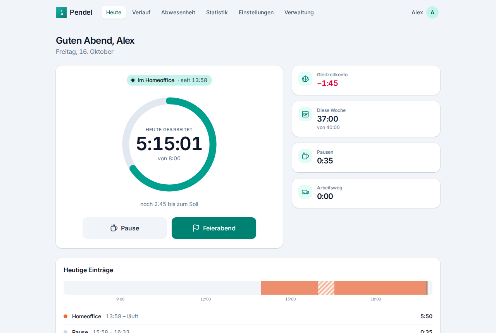
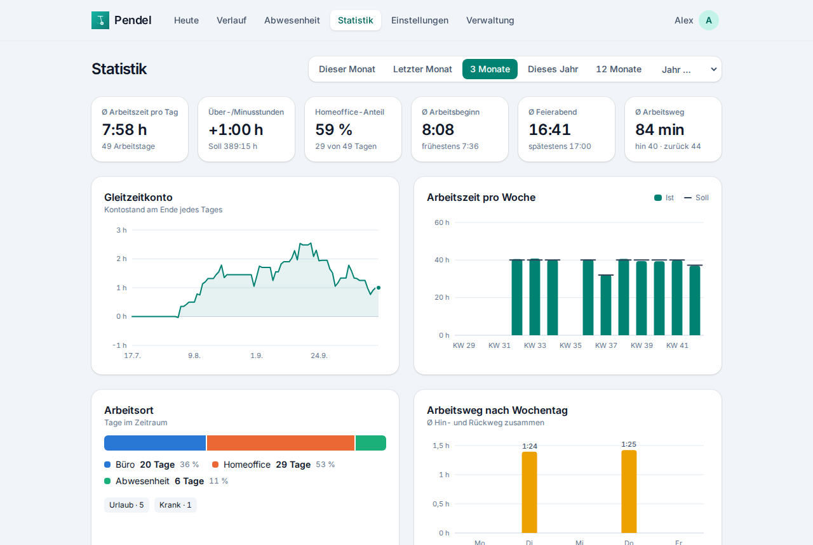
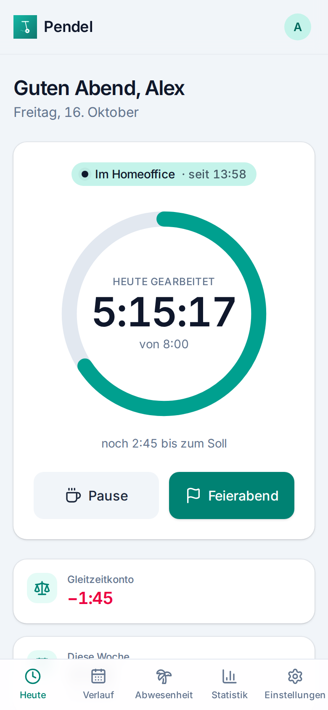
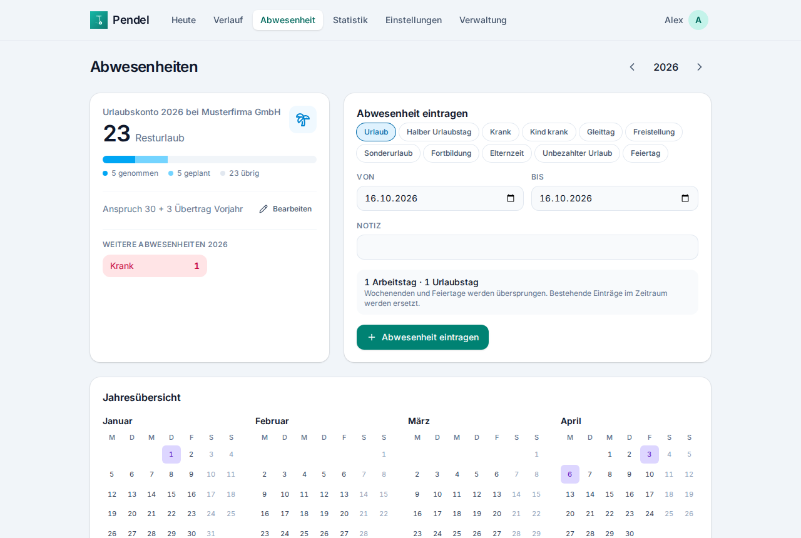
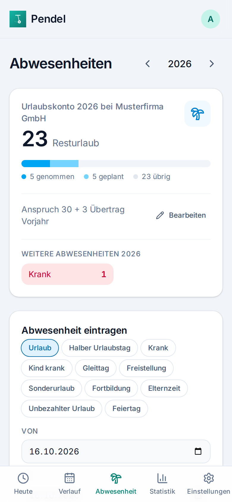

<p align="center"></p>

<h1 align="center">Pendel</h1>

<p align="center">
  Selbst gehostete Arbeitszeiterfassung für alle, die zwischen <b>Homeoffice</b> und <b>Büro</b> pendeln –
  mit Gleitzeitkonto, Urlaubsplanung und automatischer Erfassung des Arbeitswegs.
</p>

<p align="center">
  <a href="https://github.com/Schally0711/pendel/actions/workflows/ci.yml"></a>
  
  <a href="LICENSE"></a>
</p>

<p align="center">
  
  
</p>

> **Beta:** Pendel ist im Alltag im Einsatz, aber noch jung. Vor jedem Update, das die Datenbank ändert,
> legt Pendel automatisch eine Sicherung an ([Update & Backup](docs/update-und-backup.md)).

**English:** Pendel is a self-hosted work time tracker for people who split their week between home office
and office. It keeps a flexitime balance, plans vacation, follows German public holidays per state and can
record commutes and office time automatically via Home Assistant, OwnTracks or any HTTP automation. It runs as
a single Docker container with SQLite, is multi-user (invite only) and has a German and English UI.
The documentation is in German; see the [English summary](#english-summary) below.

## Funktionen

- **Stempeln** per Web-App (PWA, installierbar auf Android/iOS): Homeoffice, Büro, Pause, Arbeitsweg, Feierabend –
  auch über Schnellaktionen am App-Icon
- **Arbeitszeitmodelle** mit Soll pro Wochentag, Gleitzeit, Pausenregeln (manuell oder automatischer Abzug)
  und Prüfung der gesetzlichen Pausen und Höchstarbeitszeit (ArbZG)
- **Gleitzeitkonto** mit Startsaldo, Korrekturen und Auszahlungen; mehrere **Arbeitsverhältnisse** mit jeweils eigenem Konto
- **Abwesenheiten:** Urlaub (auch halbe Tage), Krankheit, Kind krank, Gleittag, Freistellung, Sonderurlaub,
  Fortbildung, Elternzeit, unbezahlter Urlaub – mit Urlaubskonto, Resturlaub-Übertrag und Jahreskalender
- **Feiertage** je Bundesland automatisch
- **Automatische Erfassung** über [Home Assistant](https://github.com/Schally0711/pendel-homeassistant), OwnTracks,
  iOS-Kurzbefehle, Tasker & Co.: Arbeitsweg, Bürozeit und Pausen aus Ortswechseln
- **Statistik:** Gleitzeitverlauf, Ist/Soll pro Woche und Monat, Homeoffice-Anteil, Arbeitszeitfenster, Arbeitsweg
- **Monatsbericht** zum Drucken bzw. als PDF, **CSV-Export**, **Steuerübersicht** (Entfernungspauschale, Homeoffice-Pauschale)
- **Kalender-Abo** (iCal) für Abwesenheiten und Feiertage
- **Mehrere Nutzer** per Einladungslink, Zwei-Faktor-Anmeldung (TOTP), Geräteübersicht
- Deutsch und Englisch, heller und dunkler Modus, ein Container mit SQLite

## Schnellstart mit Docker

```yaml
# compose.yaml
services:
  pendel:
    image: ghcr.io/schally0711/pendel:0.9
    container_name: pendel
    restart: unless-stopped
    ports:
      - "8000:8000"
    volumes:
      - ./data:/data
    environment:
      TZ: Europe/Berlin
```

```bash
docker compose up -d
docker logs pendel        # zeigt den Einrichtungscode für das erste Konto
```

Dann `http://<server>:8000` öffnen, den Einrichtungscode eingeben und das Admin-Konto anlegen. Weitere Personen
lädst du unter **Verwaltung** per Link ein. Für den Zugriff von unterwegs gehört Pendel hinter einen Reverse Proxy
mit HTTPS oder einen Cloudflare Tunnel – siehe [Installation](docs/installation.md).

Updates: `docker compose pull && docker compose up -d` – die Daten in `./data` bleiben erhalten.

## Dokumentation

| | |
|---|---|
| [Installation](docs/installation.md) | Docker, Reverse Proxy, Cloudflare Tunnel, ohne Docker, Einstellungen |
| [Update & Backup](docs/update-und-backup.md) | Updates, automatische Sicherungen, Wiederherstellen, Zurück auf eine ältere Version |
| [Bedienung](docs/bedienung.md) | Arbeitszeitmodell, Gleitzeit, Pausen, Abwesenheiten, Arbeitsverhältnisse, Statistik, Steuer |
| [Automatisierung](docs/automatisierung.md) | Home Assistant, OwnTracks, Kurzbefehle/Tasker, API |
| [Sicherheit & Datenschutz](docs/sicherheit-und-datenschutz.md) | Was gespeichert wird, Anmeldung, Empfehlungen |
| [Entwicklung](docs/entwicklung.md) | Lokales Setup, Tests, Aufbau des Codes |

Sicherheitslücken bitte nicht als Issue, sondern wie in [SECURITY.md](SECURITY.md) beschrieben melden.
Änderungen pro Version stehen im [CHANGELOG](CHANGELOG.md).

<p align="center">
  
  
  
</p>

## English summary

- **What:** self-hosted work time tracking (home office / office / commute), flexitime balance, vacation account,
  public holidays per German state, statistics, printable monthly time sheet, CSV export, German tax overview, iCal feed, multi-user with invitations and TOTP.
- **Install:** use the `compose.yaml` above (`ghcr.io/schally0711/pendel`, amd64 + arm64), run `docker logs pendel`
  for the one-time setup code, open `http://<host>:8000`. Data lives in the `/data` volume (SQLite).
  Put it behind an HTTPS reverse proxy or tunnel and set `PENDEL_FORWARDED_ALLOW_IPS` to the proxy address.
- **Update:** `docker compose pull && docker compose up -d`. The schema is migrated on startup; a backup of the
  database is written to `/data/backups` before every migration.
- **Automation:** Home Assistant integration ([pendel-homeassistant](https://github.com/Schally0711/pendel-homeassistant), HACS),
  OwnTracks (`POST /api/owntracks`, HTTP mode), or any HTTP client (`POST /api/events` with a Bearer token).
  Interactive API docs at `/api/docs`.
- **UI languages:** German and English (switch under *Account*).

## Lizenz

[AGPL-3.0](LICENSE). Wer Pendel verändert und anderen als Dienst anbietet, muss den geänderten Quellcode
ebenfalls bereitstellen.

Pendel ist keine Rechts- oder Steuerberatung. Die Berechnungen (Pausen nach ArbZG, Pauschalen) sind nach bestem
Wissen umgesetzt, aber ohne Gewähr.
