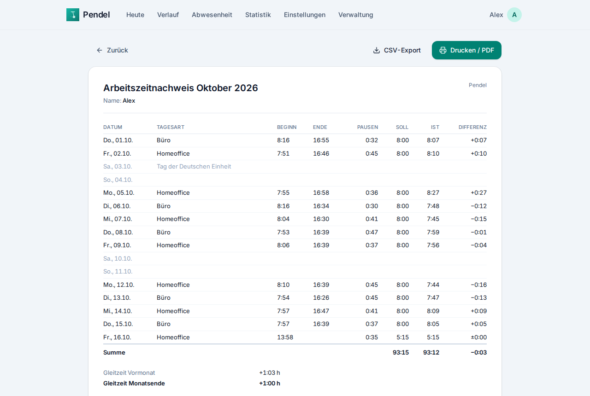

# Bedienung

- [Heute: stempeln](#heute-stempeln)
- [Verlauf und Tage bearbeiten](#verlauf-und-tage-bearbeiten)
- [Arbeitszeitmodell](#arbeitszeitmodell)
- [Pausen](#pausen)
- [Gleitzeitkonto](#gleitzeitkonto)
- [Abwesenheiten und Urlaub](#abwesenheiten-und-urlaub)
- [Arbeitsverhältnisse und Jobwechsel](#arbeitsverhältnisse-und-jobwechsel)
- [Orte und Arbeitsweg](#orte-und-arbeitsweg)
- [Statistik, Monatsbericht, Export](#statistik-monatsbericht-export)
- [Steuerübersicht](#steuerübersicht)
- [Kalender-Abo](#kalender-abo)
- [Konto, Verwaltung, mehrere Personen](#konto-verwaltung-mehrere-personen)

## Heute: stempeln

Die Startseite zeigt den aktuellen Status, die heute gearbeitete Zeit (live) und den Fortschritt zum Tagessoll.

| Knopf | Wirkung |
|---|---|
| **Homeoffice starten** / **Im Büro starten** | beginnt eine Arbeitssitzung am jeweiligen Ort |
| **Zur Arbeit losfahren** | startet den Arbeitsweg; „Im Büro angekommen“ beendet ihn und startet die Bürozeit |
| **Pause** / **Pause beenden** | erfasst eine Pause in der laufenden Sitzung |
| **Heimweg starten** | beendet die Bürozeit und startet den Heimweg; „Zuhause angekommen“ beendet ihn |
| **Feierabend** | beendet die Sitzung (und eine laufende Pause) |

Mehrere Sitzungen am Tag sind möglich, z. B. vormittags Homeoffice, nachmittags Büro. Die Zeiten werden pro Tag
zusammengezählt. Rechts stehen Gleitzeitkonto, Woche, Pausen und Arbeitsweg des Tages, darunter eine Zeitleiste
aller Einträge. Warnungen erscheinen, wenn die gesetzliche Mindestpause fehlt oder mehr als 10 Stunden gearbeitet wurden.

Auf dem Handy installiert (siehe [Installation](installation.md#app-auf-dem-handy-installieren)) gibt es
Schnellaktionen am App-Icon: *Homeoffice starten*, *Im Büro starten*, *Feierabend*.

## Verlauf und Tage bearbeiten

**Verlauf** zeigt einen Monat: Soll, Ist, Differenz, Kontostand am Monatsende, ein Balkendiagramm und alle Tage.
Ein Klick auf einen Tag öffnet den **Tageseditor**:

- Sitzungen, Pausen und Arbeitswege anlegen, ändern, löschen – auch nachträglich und für vergangene Tage
- die **Tagesart** setzen (Arbeitstag, Urlaub, krank …, siehe unten)
- bei automatisch erfassten Tagen das **Automatik-Protokoll**: welche Ortsmeldung welche Aktion ausgelöst hat

Alles, was die Automatik erfasst, ist wie ein manueller Eintrag änderbar.

## Arbeitszeitmodell

Unter **Einstellungen → Arbeitszeitmodell**:

- **Soll pro Wochentag** in Stunden (z. B. 8 h Mo–Fr = 40 h/Woche, Teilzeit mit freien Tagen = 0)
- **Gültig ab:** Modelle sind versioniert. Ändert sich dein Vertrag, legst du ein **neues** Modell ab dem
  Stichtag an – vergangene Tage behalten ihr altes Soll. Tage vor dem ersten Modell haben kein Soll.
- **Pausenregel** (siehe [Pausen](#pausen))
- **Abwesenheit vom Büro:** bis zu welcher Dauer das Verlassen und Wiederkommen ins Büro als Pause zählt (Standard 90 min)
- **Arbeitsweg zählt als Arbeitszeit (%)**: Anteil der Pendelzeit, der als Arbeitszeit gutgeschrieben wird (Standard 0 %)

Unter **Region & Zeitzone** stehen Bundesland (für Feiertage) und Zeitzone (wann ein Tag beginnt).

## Pausen

Zwei Pausenregeln stehen zur Wahl:

- **Pausen manuell erfassen:** Abgezogen wird, was du als Pause erfasst.
- **Feste Pause automatisch abziehen:** Pro Arbeitstag werden z. B. 30 Minuten abgezogen, optional erst ab einer
  Mindestarbeitszeit. Erfasst du eine längere Pause, zählt die längere.

Unabhängig davon prüft Pendel die **gesetzlichen Pausen** (§ 4 ArbZG) und warnt: mehr als 6 Stunden Arbeit
→ mindestens 30 Minuten Pause, mehr als 9 Stunden → mindestens 45 Minuten. Ebenso bei mehr als 10 Stunden Arbeit
am Tag. Die Warnung lässt sich im Arbeitszeitmodell abschalten.

**Kundentermin statt Pause:** Wer das Büro verlässt und wiederkommt, bekommt diese Zeit automatisch als Pause
erfasst, wenn sie kürzer ist als die eingestellte *Abwesenheit vom Büro*, sonst als Arbeitszeit. Im Tageseditor
lässt sich das bei jeder Pause über den Haken „zählt als Pause“ umstellen.

## Gleitzeitkonto

Das Konto ist die Summe aus *(Ist − Soll)* aller vergangenen Tage, plus **Saldo-Korrekturen**
(Einstellungen → Saldo-Korrekturen): Startsaldo beim Umstieg auf Pendel, ausbezahlte Überstunden,
sonstige Korrekturen – jeweils mit Datum, positiv oder negativ.

- Der heutige Tag zählt laufend mit; zukünftige Tage zählen erst, wenn sie da sind.
- Feiertage und die meisten Abwesenheiten sind **neutral** (Soll 0). Ein **Gleittag** behält sein Soll und wird
  damit vom Konto abgezogen.
- Startet dein Arbeitszeitmodell zu früh, ohne dass du Zeiten erfasst hast, ist das Konto stark im Minus –
  dann das „gültig ab“ des Modells auf den echten Startzeitpunkt setzen oder einen Startsaldo eintragen.

## Abwesenheiten und Urlaub

Unter **Abwesenheit** trägst du Zeiträume ein. Wochenenden, Feiertage und Tage ohne Soll werden übersprungen;
vor dem Speichern siehst du, wie viele Arbeits- und Urlaubstage es werden.

| Tagesart | Soll | Urlaubskonto |
|---|---|---|
| Urlaub | 0 | −1 Tag |
| Halber Urlaubstag | halbes Soll | −0,5 Tage |
| Krank, Kind krank | 0 | – |
| Gleittag | volles Soll (vom Konto bezahlt) | – |
| Freistellung, Sonderurlaub, Fortbildung | 0 | – |
| Elternzeit, unbezahlter Urlaub | 0 | – |
| Feiertag (manuell, z. B. lokaler Feiertag) | 0 | – |
| Arbeitstag (an einem Feiertag gearbeitet) | volles Soll | – |

Das **Urlaubskonto** pro Jahr hat einen Anspruch und einen Übertrag aus dem Vorjahr (Pendel schlägt den Resturlaub
vor). Es zeigt genommene, geplante und übrige Tage. Darunter ein **Jahreskalender** mit allen Abwesenheiten und Feiertagen.

## Arbeitsverhältnisse und Jobwechsel

Unter **Einstellungen → Arbeitsverhältnisse** stehen deine Arbeitgeber mit Beginn und Ende. Jedes
Arbeitsverhältnis hat ein **eigenes Gleitzeitkonto und Urlaubskonto**.

**Arbeitsstelle wechseln:** neuer Arbeitgeber, erster Arbeitstag, letzter Tag beim alten Arbeitgeber und
optional die Urlaubstage im ersten Jahr (oft anteilig). Pendel beendet das alte Arbeitsverhältnis, startet das neue
mit leerem Konto und übernimmt dein Arbeitszeitmodell ab dem ersten Tag – das kannst du danach anpassen.

- Tage zwischen zwei Arbeitsverhältnissen haben kein Soll.
- Beendete Arbeitsverhältnisse bleiben im Verlauf, in Statistik (eigener Zeitraum zur Auswahl) und Berichten erhalten.
- Ein beendetes Arbeitsverhältnis lässt sich mit allen Zeiten, Abwesenheiten und Korrekturen aus diesem Zeitraum löschen.

## Orte und Arbeitsweg

**Einstellungen → Orte** enthält dein Zuhause und dein Büro (weitere Orte lassen sich hinzufügen):

- **Entfernung (km)** zum Büro – für die Entfernungspauschale in der Steuerübersicht
- **Zone** – der Name, mit dem eine Automatisierung den Ort meldet (z. B. `zone.home` aus Home Assistant oder der
  Regionsname in OwnTracks). Ohne Zone wird der Ortsname verglichen.

Den Arbeitsweg erfasst du per Knopf oder automatisch, siehe [Automatisierung](automatisierung.md).

## Statistik, Monatsbericht, Export

**Statistik** wertet einen Zeitraum aus (dieser/letzter Monat, 3 Monate, dieses Jahr, 12 Monate, ein beliebiges Jahr
oder ein ganzes Arbeitsverhältnis):

- Kennzahlen: Ø Arbeitszeit pro Tag, Über-/Minusstunden, Homeoffice-Anteil, Ø Arbeitsbeginn und Feierabend, Ø Arbeitsweg
- Verlauf des Gleitzeitkontos, Arbeitszeit pro Woche bzw. Monat gegen das Soll
- Arbeitsort-Anteile, Arbeitszeitfenster der letzten Wochen, Arbeitsweg nach Wochentag
- alle Werte auch als Tabelle

Der **Monatsbericht** (im Verlauf) ist ein druckbarer Arbeitszeitnachweis mit Beginn, Ende, Pausen, Soll, Ist und
Differenz pro Tag – über *Drucken / PDF* als PDF speichern. Der **CSV-Export** enthält dieselben Daten für Excel & Co.

## Steuerübersicht

Unter der Statistik steht pro Jahr eine Übersicht für die Einkommensteuererklärung:

- **Entfernungspauschale:** Bürotage × einfache Entfernung × Satz (ab 2026: 0,38 € ab dem ersten Kilometer;
  frühere Jahre mit den damaligen Sätzen)
- **Homeoffice-Pauschale:** Tage nur im Homeoffice × 6 €, höchstens 210 Tage (bis 2022: 5 €, höchstens 120 Tage)

Ohne Gewähr – Pendel ersetzt keine Steuerberatung.

## Kalender-Abo

Auf der Seite **Abwesenheit** erstellst du unter *Kalender-Abo* einen Abo-Link (iCal) mit deinen Abwesenheiten und optional den
Feiertagen. Er funktioniert in jeder Kalender-App, die Abos unterstützt; Google Kalender braucht dafür eine
öffentlich erreichbare Adresse. Der Link enthält einen eigenen Token, der nur den Kalender lesen darf und jederzeit
widerrufen werden kann.

## Konto, Verwaltung, mehrere Personen

- **Konto** (Klick auf deinen Namen oben rechts): Name, Sprache, Passwort, Zwei-Faktor-Anmeldung, angemeldete Geräte,
  Abmelden. Details in [Sicherheit & Datenschutz](sicherheit-und-datenschutz.md).
- **Verwaltung** (nur Admins): Einladungslinks erstellen (7 Tage gültig, einmal verwendbar), Personen und ihre
  Zwei-Faktor-Anmeldung verwalten, öffentliche Adresse der Instanz.

Jede Person sieht ausschließlich ihre eigenen Daten – auch Admins sehen keine Zeiten anderer.
